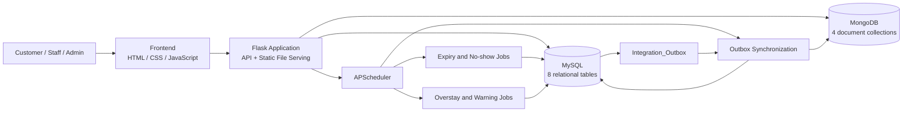
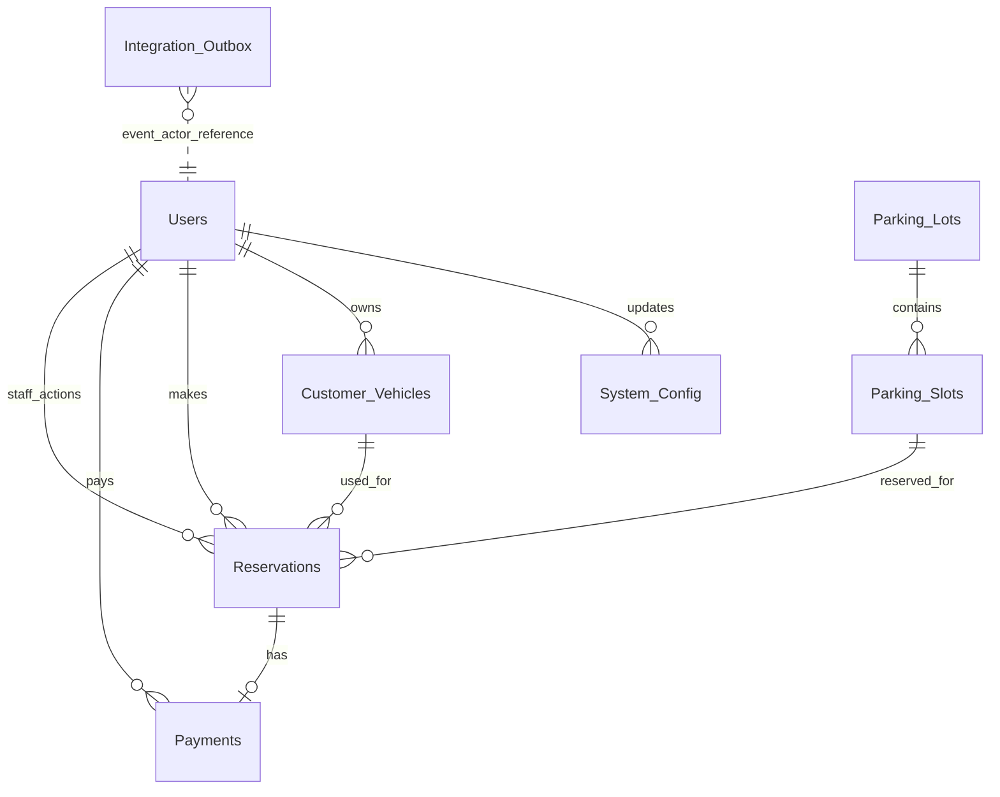
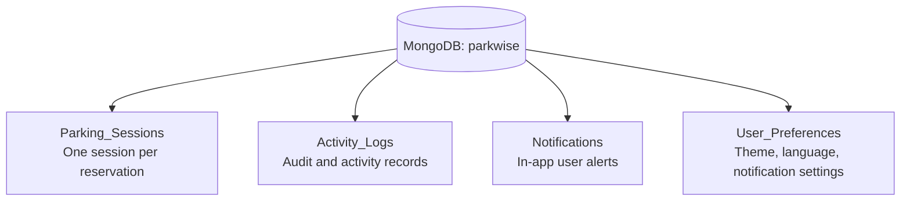
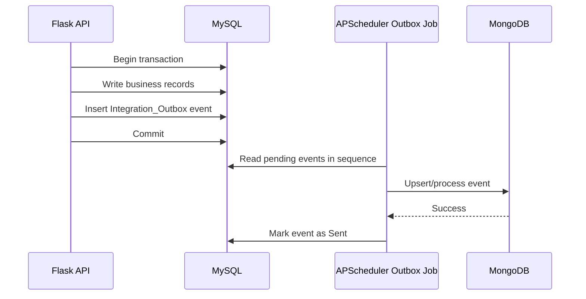

# ParkWise

**Hybrid Database Parking Management System**

**Project Presentation:** [Watch the ParkWise presentation on YouTube](https://www.youtube.com/watch?v=kzOzd3mMSYE)

ParkWise is a web-based parking management application designed to improve parking availability visibility, reservation handling, vehicle check-in/check-out, and payment record management. It uses a hybrid database design: MySQL stores structured, relationship-heavy business records, while MongoDB stores flexible operational documents such as parking sessions, activity logs, notifications, and user preferences.

> **Repository layout:** The application source is organized into root-level `backend/`, `database/`, and `frontend/` directories.

## Table of Contents

1. [Overview](#1-overview)
2. [Requirements Checklist](#2-requirements-checklist)
3. [Technology Stack](#3-technology-stack)
4. [System Architecture](#4-system-architecture)
5. [Database Design](#5-database-design)
6. [Database Concepts](#6-database-concepts)
7. [Installation and Running](#7-installation-and-running)
8. [Environment Variables](#8-environment-variables)
9. [API Documentation](#9-api-documentation)
10. [Transactions, Rollback, and CRUD Mapping](#10-transactions-rollback-and-crud-mapping)
11. [Screenshots and Presentation Video](#11-screenshots-and-presentation-video)
12. [Project Structure, Tests, and Troubleshooting](#12-project-structure-tests-and-troubleshooting)

---

## 1. Overview

### Problem

Traditional parking operations can suffer from several data-management problems:

- Drivers cannot easily identify available parking spaces.
- Multiple customers may attempt to reserve the same space.
- Overstaying can affect the next reservation.
- Parking fees and overstay charges may be calculated or recorded inconsistently.

These problems require accurate, consistent, and coordinated data management.

### ParkWise solution

ParkWise provides one web application for customers and parking operators. It combines relational data integrity in MySQL with flexible operational records in MongoDB. Reservation and payment workflows use MySQL transactions, while the Transactional Outbox Pattern coordinates events that must be reflected in MongoDB.

### User roles

| Role | Main capabilities |
|---|---|
| **Customer** | Register and log in, browse parking lots and slots, manage vehicles, create and manage reservations, and view parking/payment history, notifications, and preferences. |
| **Staff** | Search reservations, view reservation details, check vehicles in and out, and confirm cash payments. |
| **Admin** | Manage users, vehicles, parking lots, slots, reservations, payments, system configuration, MongoDB-backed operational records, and outbox events. Admin transaction demonstration endpoints are provided when demo mode is enabled. |

---

## 2. Requirements Checklist

The following maps the project specification to the implementation visible in this repository. It describes code and schema evidence; it is not a claim that every deployment restriction or runtime test has been independently verified.

| Project requirement | ParkWise implementation / evidence |
|---|---|
| Full-stack web application | Flask backend serves the frontend files from `frontend/static/`. |
| Hybrid SQL + NoSQL architecture | MySQL access in `backend/db/mysql.py`; MongoDB access in `backend/db/mongo.py`. |
| Self-hosted databases | The application is configured for MySQL and MongoDB connection URIs/hosts supplied through environment variables. Deployment must run these database servers locally or on-premise to satisfy the requirement. |
| No external APIs / microservices | The inspected application code uses its own Flask backend and database drivers. Confirm the complete deployment environment before making an absolute compliance claim. |
| At least 4 interconnected SQL tables | `schema.sql` defines **8 tables**: `Users`, `System_Config`, `Customer_Vehicles`, `Parking_Lots`, `Parking_Slots`, `Reservations`, `Payments`, and `Integration_Outbox`. It also defines SQL views. |
| At least 4 NoSQL collections | `mongo_init.js` defines **4 collections**: `Parking_Sessions`, `Activity_Logs`, `Notifications`, and `User_Preferences`, with JSON Schema validators and indexes. |
| CRUD through web UI | SQL-backed and MongoDB-backed management endpoints are implemented in the route modules. See [CRUD mapping](#crud-coverage-summary). |
| Transactional logic and rollback | MySQL transaction helpers and booking/payment services are present; admin demo handlers expose checkout-success, midway-rollback, and double-booking scenarios in their route module. |
| Documentation and diagrams | Screenshots and diagrams are stored under `docs/screenshots/`. |

**Important source observation:** `backend/app.py` currently registers the `auth`, `lots`, `me`, `reservations`, `account`, and `staff` blueprints. The `admin.py` and `admin_mongo.py` modules define admin endpoints, but they are not registered in the inspected `register_blueprints()` function. Therefore, do not assume those admin endpoints are reachable in this exact pulled snapshot until the registration is addressed and tested. This README does not silently modify the application source.

---

## 3. Technology Stack

| Layer | Technology | Purpose |
|---|---|---|
| Backend | Python 3.13, Flask | HTTP application, API routes, and serving frontend files |
| Relational database | MySQL 8 / InnoDB | Structured business data, relationships, constraints, and transactions |
| NoSQL database | MongoDB | Flexible operational documents |
| SQL driver | PyMySQL | Connect Flask services to MySQL |
| MongoDB driver | PyMongo | Connect Flask services to MongoDB |
| Configuration | python-dotenv | Load environment variables from `backend/.env` |
| Background jobs | APScheduler | Periodic expiry, outbox synchronization, and overstay jobs |
| Frontend | HTML, CSS, JavaScript | Browser-based user interface in `frontend/static/` |
| Testing | pytest | Backend and service tests |

The exact Python dependency constraints are maintained in [`backend/requirements.txt`](backend/requirements.txt).

---

## 4. System Architecture



### Main components

- **Frontend:** static web pages served by Flask.
- **Flask application:** handles HTTP requests, authentication, validation, business services, and database access.
- **MySQL:** stores core entities and transactional business records.
- **MongoDB:** stores operational documents and user-facing auxiliary data.
- **APScheduler:** starts background jobs from the Flask application when `SCHEDULER_ENABLED` is enabled.
- **Integration Outbox:** stores events in MySQL as part of the originating transaction; the background job later processes pending events into MongoDB.

The scheduler source describes these intervals: expiry/no-show processing every 30 seconds, outbox processing every 5 seconds, and overstay/warning processing every 60 seconds.

---

## 5. Database Design

### 5.1 MySQL relational schema

The SQL schema defines eight tables:

| Table | Purpose |
|---|---|
| `Users` | User accounts, credentials, and roles |
| `System_Config` | Configurable system settings and the user who updated them |
| `Customer_Vehicles` | Vehicles registered by customers |
| `Parking_Lots` | Parking lot information |
| `Parking_Slots` | Individual parking spaces within a lot |
| `Reservations` | Booking lifecycle, time range, slot, vehicle, and check-in/check-out information |
| `Payments` | Reservation payment and fee details |
| `Integration_Outbox` | Events awaiting synchronization to MongoDB |

The schema also defines `v_reservation_details`, `v_slot_current_status`, and `v_lot_availability` views.



The diagram is a high-level relationship overview. For exact columns, keys, indexes, and constraints, refer to [`database/schema.sql`](database/schema.sql) and the ER diagram image in the screenshots section.

### 5.2 MongoDB document schema

The MongoDB initialization script creates four collections and applies JSON Schema validation.

| Collection | Document purpose | Fields shown in schema |
|---|---|---|
| `Parking_Sessions` | Parking session information | `reservationId`, `userId`, `vehicleId`, `plateNumber`, `checkInAt`, `checkOutAt`, `durationMinutes`, `fees`, `isOverstay`, event IDs, timestamps |
| `Activity_Logs` | User/system activity and audit information | `userId`, `role`, `action_type`, `entity_type`, `entity_id`, `ip_address`, `metadata`, `timestamp`, `admin_note`, `is_archived`, `source_event_id` |
| `Notifications` | User notifications | `userId`, `type`, `title`, `message`, `isRead`, `reservationId`, `sentAt`, `readAt`, `source_event_id` |
| `User_Preferences` | Per-user preferences | `userId`, `theme`, `language`, `notifications`, `defaultVehicleId`, `updatedAt` |



The collection validators and indexes are defined in [`database/mongo_init.js`](database/mongo_init.js). The MongoDB schema diagram is available at [`docs/screenshots/Documentation/MongoBD_diagram.png`](docs/screenshots/Documentation/MongoBD_diagram.png).

---

## 6. Database Concepts

- **Database (DB):** an organized system for storing and retrieving application data.
- **SQL:** a relational database model that represents data in tables and supports relationships, constraints, and joins. ParkWise uses MySQL for structured and transaction-critical records.
- **NoSQL:** a non-relational model. ParkWise uses MongoDB documents for operational data whose structure is suited to document storage.
- **CRUD:** Create, Read, Update, and Delete operations used to manage application records.
- **ACID transaction:** a transaction aims to provide Atomicity, Consistency, Isolation, and Durability. ParkWise uses MySQL transactions for multi-step business operations.
- **Transactional Outbox Pattern:** the application writes business changes and an event record to MySQL in the same transaction. A background process later reads pending events and updates MongoDB. This avoids treating two independent database writes as one atomic transaction.
- **Eventual consistency:** MongoDB may temporarily lag behind MySQL while an outbox event is pending, then catch up after successful processing.

---

## 7. Installation and Running

### Prerequisites

- Python 3.13
- MySQL 8
- MongoDB compatible with the project's initialization script
- Git
- A modern web browser

### Local Development (Only)

1. Clone the repository and enter its root directory.

   ```bash
   git clone <repository-url>
   cd ParkWise
   ```

2. Create and activate a virtual environment.

   **Windows PowerShell:**
   ```powershell
   py -3.13 -m venv .venv
   .\.venv\Scripts\Activate.ps1
   ```

   **Windows Git Bash:**
   ```bash
   py -3.13 -m venv .venv
   source .venv/Scripts/activate
   ```

   **macOS / Linux:**
   ```bash
   python3.13 -m venv .venv
   source .venv/bin/activate
   ```

3. Install backend dependencies.

   ```bash
   pip install -r backend/requirements.txt
   ```

4. Create the backend environment file.

   **Windows PowerShell:**
   ```powershell
   Copy-Item backend/.env.example backend/.env
   ```

   **macOS / Linux / Git Bash:**
   ```bash
   cp backend/.env.example backend/.env
   ```

   Edit `backend/.env` and set the MySQL and MongoDB connection details for your local services. Change `SECRET_KEY` to a private random value.

5. Create the MySQL database named `parkwise`, then apply the schema and seed data. For example, if the MySQL command-line client is installed:

   ```bash
   mysql -u root -p -e "CREATE DATABASE IF NOT EXISTS parkwise CHARACTER SET utf8mb4 COLLATE utf8mb4_unicode_ci;"
   mysql -u root -p parkwise < database/schema.sql
   mysql -u root -p parkwise < database/seed.sql
   ```

6. Initialize MongoDB collections and validators using `mongosh`:

   ```bash
   mongosh "mongodb://127.0.0.1:27017/parkwise" database/mongo_init.js
   ```

7. Seed MongoDB demo documents using the project's script. Run from the repository root after the environment file and both databases are ready:

   ```bash
   python database/seed_mongo.py
   ```

   Check the script's command-line options and database assumptions before using it against a database that contains data you need to preserve.

8. Start Flask. The application is configured to use port **5050** and binds to `127.0.0.1` for local development.

   ```bash
   cd backend
   python app.py
   ```

9. Open the application:

   `http://127.0.0.1:5050`

To stop the server, press `Ctrl+C`. To leave the virtual environment, run `deactivate`.

### Demo accounts

The seed SQL documents these demo users. The test fixture specifies the shared seed password as `Passw0rd!`.

| Role | Email | Password |
|---|---|---|
| Admin | `admin@parkwise.local` | `Passw0rd!` |
| Staff | `staff1@parkwise.local` | `Passw0rd!` |
| Staff | `staff2@parkwise.local` | `Passw0rd!` |
| Customer | `somchai@example.com` | `Passw0rd!` |
| Customer | `suda@example.com` | `Passw0rd!` |
| Customer | `anan@example.com` | `Passw0rd!` |
| Customer | `malee@example.com` | `Passw0rd!` |
| Customer | `preecha@example.com` | `Passw0rd!` |

These are demo credentials from the seed/test files. Do not use them in a public production deployment. The `/api/auth/demo-accounts` endpoint is gated by `DEMO_MODE`, but `DEMO_MODE` is not present in the supplied `.env.example`.

---

## 8. Environment Variables

The following variables are documented in [`backend/.env.example`](backend/.env.example).

| Variable | Example/default in template | Description |
|---|---|---|
| `SECRET_KEY` | `dev-only-secret-change-me` | Flask session/signing secret. Replace before use outside local development. |
| `FLASK_DEBUG` | `1` | Enables Flask debug mode when truthy. |
| `MYSQL_HOST` | `127.0.0.1` | MySQL server hostname. |
| `MYSQL_PORT` | `3306` | MySQL server port. |
| `MYSQL_USER` | `root` | MySQL username. |
| `MYSQL_PASSWORD` | empty | MySQL password. |
| `MYSQL_DB` | `parkwise` | MySQL database name. |
| `MONGO_URI` | `mongodb://127.0.0.1:27017` | MongoDB connection URI. |
| `MONGO_DB` | `parkwise` | MongoDB database name. |
| `MONGO_TIMEOUT_MS` | `800` | MongoDB operation/server selection timeout setting used by the app. |
| `SESSION_TIMEOUT_MINUTES` | `30` | Session lifetime in minutes. |
| `SESSION_COOKIE_SECURE` | `0` | Set to `1` only when serving over HTTPS. |
| `SCHEDULER_ENABLED` | `1` | Enables background jobs; set to `0` to disable. |

`backend/config.py` also reads `DEMO_MODE` for the admin transaction demo gate. Add it to your private `.env` as `DEMO_MODE=1` only when you intentionally want to enable the demo endpoints. It is not listed in the supplied `.env.example`.

Never commit `backend/.env` or real credentials. Commit the `.env.example` template instead.

---

## 9. API Documentation

All endpoints below are taken from the route decorators in `backend/routes/`. The API returns JSON responses. Data-changing requests are protected by the application's CSRF mechanism and require the CSRF token returned during login (normally sent in the `X-CSRF-Token` header).

### Authentication — `/api/auth`

| Method | Endpoint | Purpose |
|---|---|---|
| GET | `/demo-accounts` | Return demo account details when demo mode is enabled |
| POST | `/register` | Register a customer account |
| POST | `/login` | Authenticate and start a session |
| POST | `/logout` | End the current session |
| GET | `/me` | Get the current authenticated user |

### Public parking — `/api`

| Method | Endpoint | Purpose |
|---|---|---|
| GET | `/lots` | List parking lots |
| GET | `/lots/<lot_id>/slots` | List slots for a parking lot |
| GET | `/config/public` | Read public system configuration |

### Customer profile and activity — `/api/me`

| Method | Endpoint | Purpose |
|---|---|---|
| GET | `/profile` | Read profile |
| PATCH | `/profile` | Update profile |
| POST | `/password` | Change password |
| GET / POST | `/vehicles` | List or add vehicles |
| PATCH / DELETE | `/vehicles/<vehicle_id>` | Update or remove a vehicle |
| POST | `/vehicles/<vehicle_id>/default` | Set default vehicle |
| GET | `/reservations` | List the current user's reservations |
| GET | `/reservations/<reservation_id>` | Read one reservation |
| GET | `/parking` | Read current/previous parking information |
| GET | `/dashboard` | Read customer dashboard data |

### Reservations — `/api/reservations`

| Method | Endpoint | Purpose |
|---|---|---|
| POST | `/` | Create a reservation |
| POST | `/<reservation_id>/confirm` | Confirm a reservation |
| POST | `/<reservation_id>/cancel` | Cancel a reservation |

### Customer account data — `/api` (account blueprint)

| Method | Endpoint | Purpose |
|---|---|---|
| GET | `/notifications` | List notifications |
| PATCH | `/notifications/<nid>/read` | Mark one notification as read |
| POST | `/notifications/read-all` | Mark all notifications as read |
| DELETE | `/notifications/<nid>` | Delete one notification |
| GET / PUT / DELETE | `/preferences` | Read, update, or reset preferences |
| GET | `/sessions` | List parking sessions |
| GET | `/payments` | List the current user's payments |
| POST | `/payments/<payment_id>/pay` | Pay a payment |
| GET | `/payments/<payment_id>/qr` | Get payment QR data/image response |

### Staff operations — `/api/staff`

| Method | Endpoint | Purpose |
|---|---|---|
| GET | `/search` | Search reservations/vehicles |
| GET | `/reservations/<reservation_id>` | Read reservation detail |
| POST | `/reservations/<reservation_id>/checkin` | Check a vehicle in |
| POST | `/reservations/<reservation_id>/checkout` | Check a vehicle out |
| POST | `/payments/<payment_id>/cash` | Confirm cash payment |
| GET | `/dashboard` | Read staff dashboard |
| GET | `/movements` | Read parking movements |

### Admin routes defined in source (registration caveat)

`admin.py` and `admin_mongo.py` define additional endpoints under `/api/admin`, including user/vehicle/lot/slot/reservation/payment management, configuration, outbox processing, MongoDB sessions, notifications, preferences, activity logs, and transaction demos. However, these two blueprints are **not registered** in `backend/app.py` in the supplied snapshot. Their route definitions are therefore documented as source-defined functionality, not as verified reachable endpoints. Registering them is a source-code change and is intentionally outside this README-only task.

---

## 10. Transactions, Rollback, and CRUD Mapping

### 10.1 Transaction approach

ParkWise uses MySQL transactions for operations that must preserve relational consistency. The schema includes constraints for reservation time ranges, reservation states, payment amounts, and related records. The service layer includes booking, check-in/check-out, payment, and outbox functionality.

### 10.2 Outbox synchronization flow



If MongoDB is unavailable, pending outbox events can remain in MySQL and be retried by the background processing mechanism. This is eventual synchronization; it is not a distributed ACID transaction spanning both databases.

### 10.3 Transaction demonstration

The admin route module defines demo operations for:

- Successful checkout (`/api/admin/demo/checkout-success`)
- Midway rollback (`/api/admin/demo/midway-rollback`)
- Double-booking attempt (`/api/admin/demo/double-booking`)
- Simulated MongoDB outage and retry (`/api/admin/demo/mongo-down`, `/api/admin/demo/mongo-retry`)

These routes are gated by `DEMO_MODE=1`. As noted above, the admin blueprint is not registered in the supplied `app.py` snapshot, so the demo routes are not currently verified as reachable from the running application.

### 10.4 CRUD coverage summary

| Data area | Database | Operations represented in source |
|---|---|---|
| Users and roles | MySQL | Create, read, update, deactivate/unlock |
| Customer vehicles | MySQL | Create, read, update, soft-delete |
| Parking lots and slots | MySQL | Create, read, update, delete |
| Reservations | MySQL | Create, read, update/cancel, delete/admin management |
| Payments | MySQL | Create, read, update, delete/admin management |
| Parking sessions | MongoDB | Create, read, update, delete (admin route module) |
| Notifications | MongoDB | Create, read, update, delete |
| User preferences | MongoDB | Create/set, read, update, reset/delete |
| Activity logs | MongoDB | Create, read, update, delete/archive |

CRUD coverage in the source does not imply that every route is currently reachable; see the admin blueprint registration caveat in Section 9.

---

## 11. Screenshots and Presentation Video

All screenshot and diagram image files referenced below are existing assets from this repository under `docs/screenshots/`; no externally generated or AI-generated images are used. The Mermaid diagrams elsewhere in this README are text-based diagrams rendered by GitHub, not uploaded image files.

### Application screenshots

**SQL Features (MySQL)**

| Screenshot | Preview |
|---|---|
| Login page | /login_page.png>) |
| Create account | /create_account_page.png>) |
| Customer parking lots | /customer_parking_lot.png>) |
| Customer reservation | /customer_reservation.png>) |
| Customer parking history | /customer_parking_history.png>) |
| Admin parking lots | /admin_parking_lot.png>) |
| Admin reservations | /admin_reservation.png>) |
| Admin payments | /admin_payments.png>) |

**NoSQL Features (MongoDB)**

| Screenshot | Preview |
|---|---|
| Customer notifications |  |
| Customer preferences |  |
| Admin activity log |  |
| Admin notifications |  |
| Admin parking sessions |  |

### Transaction proof

| Scenario | Screenshot |
|---|---|
| Checkout after commit |  |
| Double booking refused |  |
| Midway rollback |  |
| MongoDB unavailable |  |
| MongoDB recovered |  |

### Diagrams

- [SQL ER Diagram](docs/screenshots/Documentation/ER_diagram.png)
- [MongoDB Document Schema Diagram](docs/screenshots/Documentation/MongoBD_diagram.png)
- [Software Architecture Diagram](docs/screenshots/Documentation/software_achitecture_diagram.png)


---

## 12. Project Structure, Tests, and Troubleshooting

### 12.1 Project structure

The repository uses a root-level layout. The `backend/`, `database/`, and `frontend/` directories contain the application source and supporting database scripts.

```text
ParkWise/
├── backend/
│   ├── core/
│   ├── db/
│   ├── jobs/
│   ├── routes/
│   ├── services/
│   ├── tests/
│   ├── .env.example
│   ├── app.py
│   ├── config.py
│   └── requirements.txt
├── database/
│   ├── migrations/
│   ├── mongo_init.js
│   ├── reset_demo.py
│   ├── schema.sql
│   ├── seed.sql
│   └── seed_mongo.py
├── frontend/
│   └── static/
├── .gitignore
├── LICENSE
└── README.md
```

The `backend/`, `database/`, and `frontend/` directories contain the application source. This README documents local development without Docker.

### 12.2 Running tests

Run tests from the backend directory after configuring a separate test database and installing dependencies:

```bash
cd backend
pytest
```

The test fixture defaults to a MySQL database named `parkwise_test` and rebuilds it from the project schema and seed data. It is designed to avoid using the normal demo database. Ensure the configured MySQL account can create/reset that test database before running the suite. Some MongoDB-related tests use `mongomock`; integration tests may require working database services.

### 12.3 Troubleshooting

| Problem | Things to check |
|---|---|
| Flask cannot connect to MySQL | Confirm MySQL is running and `MYSQL_HOST`, `MYSQL_PORT`, `MYSQL_USER`, `MYSQL_PASSWORD`, and `MYSQL_DB` in `backend/.env` are correct. |
| MongoDB is unavailable | Confirm `mongod` is running and `MONGO_URI` / `MONGO_DB` are correct. Run `mongo_init.js` against the intended database. |
| Login fails for demo users | Confirm `seed.sql` was applied to the `parkwise` database and use the seed password shown above. |
| Frontend page not found | Start Flask from `backend` and confirm `frontend/static/index.html` exists. |
| Scheduler does not start | Check `SCHEDULER_ENABLED=1` and inspect the Flask startup logs. |
| Admin endpoints return 404 | In this repository snapshot, `admin.py` and `admin_mongo.py` are not registered in `backend/app.py`. |
| Test suite cannot create test DB | Check MySQL privileges and the `TEST_MYSQL_DB` setting described in `backend/tests/conftest.py`. |

---

## License

See the [`LICENSE`](LICENSE) file for license terms.
